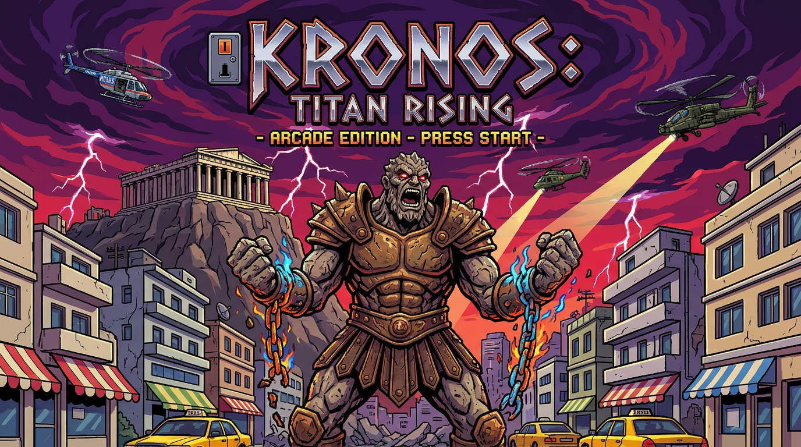

# 🏛️ ATHENS RAMPAGE: ΤΙΤΑΝΕΣ ΣΤΗΝ ΑΚΡΟΠΟΛΗ 🏛️
### An Addictive, Gory Rampage-Style 2D Arcade Game set in Modern Athens & the Acropolis!



> **"Γκρεμίστε τις Πολυκατοικίες, Φάτε τους Τουρίστες, Αποφύγετε τα Κίτρινα Ταξί και Νικήστε τον Μηχανικό Μινώταυρο της ΑΑΔΕ!"**

Created for **Google Cloud Day Athens 2026** Mini Game Jam using **Go + Ebitengine (v2)**, compiling to **Native Desktop** and **WebAssembly (WASM)**.

---

## 🎮 Game Overview & Inside Jokes

**Athens Rampage** is an explosive, gory 1986 *Rampage* arcade homage set in Athens. Control an Ancient Greek Mythological Titan climbing iconic Athenian *polykatoikies* (with orange awnings, balconies, and solar water heaters), smashing windows, devouring tourists and locals with pixel blood fountains, flying bones, and leather sandals, and fighting through 5 Athens stages up to a final boss showdown at the Parthenon!

### 👹 The 3 Mythological Titans
1. **ΚΡΟΝΟΣ (Ο Αιμοβόρος Τιτάνας)**: +40% Αίμα & Ζωή από καταβρόχθιση ανθρώπων! *Special: ΔΡΕΠΑΝΙ & ΚΕΡΑΥΝΟΣ ΤΑΡΤΑΡΟΥ*.
2. **ΤΥΦΩΝΑΣ (Ο Δρακο-Τιτάνας της Φωτιάς)**: +35% Ταχύτητα Σκαρφαλώματος & Πύρινη Ανάσα! *Special: ΚΑΤΑΙΓΙΔΑ ΛΑΒΑΣ ΤΟΥ ΟΛΥΜΠΟΥ*.
3. **ΠΟΛΥΦΗΜΟΣ (Ο Ανθρωποφάγος Κύκλωπας)**: +50% Ζημιά Κατεδάφισης στις πολυκατοικίες! *Special: ΣΕΙΣΜΟΣ ΤΟΥ ΕΓΚΕΛΑΔΟΥ (10 ΡΙΧΤΕΡ)*.

### 🏛️ The 5 Athens Stages
- **Πίστα 1: Μοναστηράκι & Πλάκα**: Τουρίστες με κάλτσα-σανδάλι, κράχτες ταβέρνας, Airbnb και πιτόγυρο 4,80€!
- **Πίστα 2: Σύνταγμα & Ερμού**: Κίτρινα ταξί που αλλάζουν βάρδια, ψώνια στην Ερμού και εφοριακοί!
- **Πίστα 3: Εξάρχεια & Ομόνοια**: Πορτοκαλί τέντες του '70, απλήρωτα κοινόχρηστα, ντελιβεράδες και γιαγιάδες με παντόφλες!
- **Πίστα 4: Κηφισός (Ώρα Αιχμής) & Πύργος Αθηνών**: Μποτιλιάρισμα στη Λένορμαν, οδηγοί στη ΛΕΑ και managers σε Zoom!
- **Πίστα 5: Ιερός Βράχος Ακρόπολης & Boss Fight**: Παρθενώνας, Προπύλαια και ο πανίσχυρος **Mecha-Μινώταυρος της ΑΑΔΕ (ΦΠΑ 24% Laser)**!

---

## 🕹️ Controls (Χειρισμός)

| Action | Keyboard / Mouse |
| :--- | :--- |
| **Move / Walk** | **Left / Right** or **A / D** |
| **Climb Polykatoikia** | **Up / Down** or **W / S** (attach to building wall) |
| **Smash / Punch** | **J** / **Z** or **Left Click** |
| **Grab & Devour Victim** | **K** / **X** or **Right Click** (restores HP with blood fountain!) |
| **Olympus Wrath (Special)** | **SPACE** or **E** (when Rage meter is 100%) |
| **Toggle Audio Mute** | **M** |
| **Toggle Fullscreen** | **F11** or **Alt+Enter** |

---

## 🚀 How to Run & Play

### Option 1: Native Desktop (Fastest Performance)
Run directly with Go:
```bash
go run ./cmd/game
```
Or execute the pre-compiled binary:
```bash
./game.exe
```

### Option 2: WebAssembly in Browser
Serve the `public/` directory with Python or Go:
```bash
python -m http.server 8080 --directory public
```
Then open: **[http://localhost:8080](http://localhost:8080)** in Chrome/Edge/Firefox.

### Option 3: Sidecar Playtest in Antigravity
Open the **Game Dev Studio** sidecar panel directly in Antigravity:
- [Game Dev Studio](sidecar://agy-game-studio/studio/playtest)
- [Sprite Editor](sidecar://agy-game-studio/studio/sprite)
- [Sound Editor](sidecar://agy-game-studio/studio/sound)

### Option 4: Deploy to Cloud Run
Build and deploy the container in one command:
```bash
gcloud run deploy athens-rampage --source . --region europe-west1 --allow-unauthenticated
```

---

# Vibe Code a 2D Game with Gemini and Antigravity 2.0


Materials, setup instructions, and environment verification toolkit for the **"Vibe Code a 2D Game with Gemini and Antigravity 2.0"** workshop and Mini Game Jam at **Google Cloud Day Athens 2026** (November 10, 2026).

## Who am I?

DISCLAIMER: I AM NOT A GAME DEVELOPER.


I am [Daniela Petruzalek](https://linkedin.com/in/petruzalek), a Developer Relations Engineer at Google. I am the author and facilitator of this workshop. I might not be a game developer, but I am a lifetime gamer and game collector, and I enjoy using projects like this to teach modern software engineering concepts like agentic coding, generative AI, and creative ways to build software with AI!

- **LinkedIn**: [linkedin.com/in/petruzalek](https://linkedin.com/in/petruzalek)
- **X / Twitter**: [x.com/danicat83](https://x.com/danicat83)
- **Blog**: [danicat.dev](https://danicat.dev)

---

## Session Overview

After a quick introduction, participants will build 2D games in Go with the assistance of Gemini and Antigravity. This workshop includes a curated set of Agent Skills and UI Extensions for Antigravity to create a rich developer experience. Once you complete the setup steps, start your session by activating `/vibe-game-developer` (and open the live workbench with `/game-dev-studio`) to design, build, and playtest your game!

At the end of the session the participants will be invited to showcase their games. Compile your game to WASM and deploy it to Cloud Run to share it with the world!

---

## Quick Start

### 1. Activate Your Temporary Account

If you received a temporary Google Cloud workshop credit card at the event:

1. Open an **incognito** window in your browser (Chrome recommended).
2. Navigate to [console.cloud.google.com](https://console.cloud.google.com) and sign in using the credentials printed on your card.
3. Note your **Google Cloud Project ID** from the console dashboard.

### 2. Clone the Repository & Run `check_env.sh`

Choose either your **local machine** (with [Antigravity 2.0](https://antigravity.google/download)) or **[Google Cloud Shell](https://shell.cloud.google.com)** in your incognito browser window, then clone this repository and run `./check_env.sh`:

```bash
git clone https://github.com/danicat/cd-athens-2026.git
cd cd-athens-2026
./check_env.sh
```

To automatically install missing tools and plugins, enable the required Google Cloud APIs, and authenticate with your workshop Project ID in a single command, run:

```bash
./check_env.sh --fix YOUR_PROJECT_ID
```

Make sure `./check_env.sh` completes successfully before moving on to the next step.

### 3. Open Antigravity and activate /vibe-game-developer

> **Hint**: If Antigravity 2.0 was already open while running `./check_env.sh --fix` or installing plugins (such as `agy-game-studio`), reload the Antigravity 2.0 window with **`Cmd+Shift+R`** (`Ctrl+Shift+R` on Windows/Linux) so the new plugins and skills load into your session.

The `/vibe-game-developer` is the entry point skill for this workshop. This skill is installed as part of the [agy-game-studio](https://github.com/danicat/agy-game-studio) plugin.

Example activation:
```
/vibe-game-developer create a game about cats
```

You are ready to build your game!

Note: the sections below describe each individual component in details and are provided for reference only.

---

## Dependencies & Setup

### 1. System-Level Dependencies

| Dependency | Purpose | Installation |
| :--- | :--- | :--- |
| **Go 1.26+** | Compiling [Ebitengine v2](https://ebitengine.org) games to native binaries and WebAssembly (`GOOS=js GOARCH=wasm`) | [go.dev/dl](https://go.dev/dl/) or `brew install go` |
| **Google Cloud SDK (`gcloud`)** | Vertex AI / Gemini Enterprise authentication (`ADC`) and deploying WebAssembly games to **Cloud Run** | [cloud.google.com/sdk/docs/install](https://cloud.google.com/sdk/docs/install) or `brew install --cask google-cloud-sdk` |
| **Antigravity 2.0** | Desktop AI-first development platform and side-panel studios | [antigravity.google/download](https://antigravity.google/download) |
| **Antigravity CLI (`agy`)** | Terminal-based coding agent (used on local terminals or Google Cloud Shell) | `curl -fsSL https://antigravity.google/cli/install.sh \| bash` (or see [antigravity.google/download](https://antigravity.google/download)) |
| **`uv` & `python3`** | Python package and script runner for **Nano Banana** (`banana.py`), **Lyria** (`lyria.py`), and **Gemini Omni** (`omni.py`) Vertex AI scripts | `curl -LsSf https://astral.sh/uv/install.sh \| sh` and [python.org/downloads](https://www.python.org/downloads/) (or `brew install uv python`) |

---

### 2. Antigravity Plugin Dependencies

This workshop uses two Antigravity 2.0 plugins that bundle skills, rules, MCP servers, and interactive side-panel studios.

#### A. Antigravity 2D Game Studio (`agy-game-studio`) (*Required*)

- **Repository**: [github.com/danicat/agy-game-studio](https://github.com/danicat/agy-game-studio)
- **Game Dev Studio UI Extension (`/game-dev-studio`)**: includes editors for music, sound effects and sprites and a playtest environment where you can annotate your game to collaborate with Gemini
- **13 Bundled Skills**:

| Skill | What it does |
| :--- | :--- |
| [`vibe-game-developer`](https://github.com/danicat/agy-game-studio/blob/main/skills/vibe-game-developer/SKILL.md) | Primary entrypoint and workflow router (`/vibe-game-developer`) that coordinates the end-to-end 2D game development lifecycle across design, engine architecture, visual assets, audio, playtesting, and Go quality control. |
| [`game-design`](https://github.com/danicat/agy-game-studio/blob/main/skills/game-design/SKILL.md) | Interactive game co-creation workflow (`/grill-me`) and Game Design Document (`GDD.md`) authoring guide covering core loops, controls, camera projections, and asset pipeline choices across all 2D genres. |
| [`ebitengineer`](https://github.com/danicat/agy-game-studio/blob/main/skills/ebitengineer/SKILL.md) | Engineering architecture and best practices for building 2D games in Go with Ebitengine v2, including scene state machines, virtual resolution scaling, fixed-timestep physics, zero-allocation draw loops, 4-byte aligned PCM audio, Kage shaders, and WebAssembly builds. |
| [`game-dev-studio`](https://github.com/danicat/agy-game-studio/blob/main/skills/game-dev-studio/SKILL.md) | Opens the Game Dev Studio side-panel UI extension (`/game-dev-studio`) with the **Playtest tab** (`🎮 Playtest`), **Sound tab / Sound Editor** (`🎹 Sound`), and **Sprite tab / Sprite Editor** (`🎨 Sprites`). |
| [`sprite-design`](https://github.com/danicat/agy-game-studio/blob/main/skills/sprite-design/SKILL.md) | Complete guide and `.sprite` engine for 2D game sprites, tilesets, and frame animations in Ebitengine, featuring the 2-step AI Character Sheet to Sprite Grid normalization pipeline (`normalize` into `.sprite`, `.aseprite`, `.png`, and `.json`), procedural SDF/pixel-art `.sprite` definitions, and zero-allocation `AnimationController`. |
| [`nano-banana`](https://github.com/danicat/agy-game-studio/blob/main/skills/nano-banana/SKILL.md) | Generates character turnaround sheets, `4x4` chroma-key sprite grids, tilesets, parallax backgrounds, and title screen art with Nano Banana (`gemini-nano-banana-2.1`, `gemini-3.1-flash-lite-image`, `gemini-3.1-flash-image`, `gemini-3-pro-image`) via `uv run skills/nano-banana/scripts/banana.py` and Google Gen AI SDKs. |
| [`procedural-sfx`](https://github.com/danicat/agy-game-studio/blob/main/skills/procedural-sfx/SKILL.md) | Synthesizes 4-byte aligned 16-bit 44.1 kHz stereo PCM game sound effects in memory from `.sfx` DSL scripts with PolyBLEP anti-aliasing, 18 built-in archetype presets, SVF filter sweeps, 16-bit Galois LFSR chiptune noise, and production quality validation. |
| [`procedural-music`](https://github.com/danicat/agy-game-studio/blob/main/skills/procedural-music/SKILL.md) | Composes, validates, and synthesizes multi-channel 16-bit stereo BGM from `.music` DSL scores using pure-Go SEGA Mega Drive YM2612 FM + SN76489 PSG synthesis or native macOS Apple CoreAudio GM instruments (`-apple`). |
| [`lyria`](https://github.com/danicat/agy-game-studio/blob/main/skills/lyria/SKILL.md) | Generates 44.1 kHz stereo soundtracks, full vocal songs, and 30-second instrumental loops from text prompts or concept art using Google Lyria (`lyria-3.5` and `lyria-3-clip-preview`) via `uv run skills/lyria/scripts/lyria.py` and Google Gen AI SDKs. |
| [`gemini-omni`](https://github.com/danicat/agy-game-studio/blob/main/skills/gemini-omni/SKILL.md) | Conversational video generation, multimodal video editing, first-and-last-frame interpolation, and video extension (360p to 4K with synchronized audio) using Gemini Omni Flash 1.2 & 1.1 (`gemini-omni-flash-1.2-preview`, `gemini-omni-1.1-flash`) via `uv run skills/gemini-omni/scripts/omni.py` and Google Gen AI SDKs. |
| [`godoctor`](https://github.com/danicat/agy-game-studio/blob/main/skills/godoctor/SKILL.md) | Optional Go quality control and architectural safety toolset orchestrating `gofmt`, `goimports`, `go vet`, `modernize`, `golangci-lint`, compiler rollback gates, TestQuery SQLite analytics, and Selene mutation testing. |
| [`swarm-coding`](https://github.com/danicat/agy-game-studio/blob/main/skills/swarm-coding/SKILL.md) | Optional divide-and-conquer multi-agent swarm orchestrator with Coordinator, Lead, and Specialist roles and strict Single Writer file boundaries for concurrent multi-package development. |
| [`parallel`](https://github.com/danicat/agy-game-studio/blob/main/skills/parallel/SKILL.md) | Optional general-purpose task parallelization and subagent scaling engine for flat disjoint task fan-out, reactive worker queues, and Best-of-N tournaments. |

**Manual Install**:

```bash
# Via Antigravity 2.0 / IDE global plugins folder (or run ./check_env.sh --fix YOUR_PROJECT_ID)
git clone https://github.com/danicat/agy-game-studio.git ~/.gemini/config/plugins/agy-game-studio

# Or via Antigravity CLI (agy)
agy plugin install https://github.com/danicat/agy-game-studio
```

#### B. Google Cloud Developer Plugin (`google-cloud-developer`) (*Required*)

- **Repository**: [github.com/google/skills/tree/main/plugins/cloud/google-cloud-developer](https://github.com/google/skills/tree/main/plugins/cloud/google-cloud-developer)
- **What it provides**:
  - **Developer Knowledge MCP Server**: Grounded, real-time retrieval of official Google Cloud documentation.
  - **Bundled Skills & Guardrails**: `gcloud` CLI validation and safety guardrails, `google-cloud-recipe-auth`, `google-cloud-recipe-onboarding`, `finding-google-skills`, and `retrieving-developer-knowledge`.

**Install**:

- **In Antigravity 2.0**: Open **Customizations > Marketplace** in the left sidebar, search for **Google Cloud Developer**, and click **Add**.
- **Via Terminal / Script**: Run `./check_env.sh --fix YOUR_PROJECT_ID` (or clone from `google/skills`):

```bash
TMP_SKILLS="$(mktemp -d)" && \
  git clone --depth 1 https://github.com/google/skills.git "$TMP_SKILLS" && \
  cp -R "$TMP_SKILLS/plugins/cloud/google-cloud-developer" ~/.gemini/config/plugins/google-cloud-developer && \
  rm -rf "$TMP_SKILLS"
```

> **Note**: After cloning plugins into `~/.gemini/config/plugins/`, reload Antigravity 2.0 with **`Cmd+Shift+R`** (`Ctrl+Shift+R` on Windows/Linux) and check **Customizations > Installed** to ensure they are enabled.

---

## Submissions (Cloud Day Mini Game Jam)

- **Format**: Solo or small teams
- **Tech Stack**: Go 1.26+, Ebitengine v2, Antigravity 2.0 / `agy` CLI, Nano Banana, and Lyria
- **Theme**: Announced live during the workshop kickoff!

### 1. Compile your game to WebAssembly

Ask Antigravity to compile your game to WebAssembly (WASM). It will also create a companion web server that you can use to test the game via localhost. This is the same process used to compile your game for the playtest tab in `/game-dev-studio`.

### 2. Deploy the game to Cloud Run

Deploy your WebAssembly game container to Google Cloud Run directly from source:

```bash
gcloud run deploy my-athens-game \
  --source . \
  --region europe-west1 \
  --allow-unauthenticated \
  --project YOUR_PROJECT_ID
```

Once deployment finishes, Cloud Run prints your public game URL (`https://my-athens-game-...run.app`). Open it in Chrome to verify your game loads and plays smoothly in the browser.

Hint: if you want your game to be playable on mobile devices, ask Antigravity to add Tap controls and/or a virtual keyboard.

### 3. Submit via GitHub Issue

1. Open a new issue on [**github.com/danicat/cd-athens-2026/issues/new/choose**](https://github.com/danicat/cd-athens-2026/issues/new/choose).
2. Select the **Mini Game Jam Submission** template.
3. Paste the public Cloud Run link to your game in the issue body.
4. *(Optional)* Upload your game's source code to a GitHub repository and include the link in your issue.
5. Click **Create** to submit your entry for the live showcase!

---

## Repository Structure

```text
.
├── .github/
│   └── ISSUE_TEMPLATE/
│       └── game-jam-submission.md  # Issue template for Mini Game Jam submissions
├── check_env.sh                    # Pre-flight environment & plugin check script
├── chibi_dani_oops.png             # Author avatar illustration
├── logo.png                        # Cloud Day Athens 2026 pixel-art banner
├── LICENSE                         # Apache 2.0 License
└── README.md
```

---

## License

Licensed under the Apache License, Version 2.0. See [LICENSE](LICENSE) for details.

---

## Disclaimer

This is not an officially supported Google product. It is an experimental project created for educational and development purposes.
